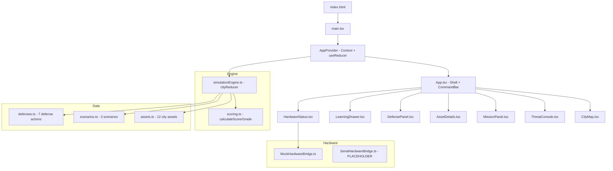

# Cyberpunk Smart City Under Attack 🏙️⚡

> An interactive cybersecurity education simulation — defend a fictional smart city as the Cyber Defense Commander


---

## ⚠️ Safe-Use Statement

This is a **100% ethical, defensive cybersecurity education project**.

- ✅ All incidents are **fictional simulations only**
- ✅ No real hacking tools, exploit code, or network attacks
- ✅ No external network connections — fully offline capable
- ✅ No real personal data is collected or processed
- ✅ All log messages are prefixed with `[SIMULATION]`
- ✅ Intended for school exhibitions, classrooms, and awareness events

**This project must never be used to target real systems.** See [SECURITY.md](SECURITY.md) for details.

---

## 📸 Screenshots

> _Screenshots coming soon — run the project locally to see the full experience._

| City Map | Defense Command | Mission Report |
|----------|----------------|----------------|
| _[City map screenshot]_ | _[Defense panel screenshot]_ | _[Mission report screenshot]_ |

---

## ✨ Features

- **Interactive City Map** — 12 clickable city assets across 4 districts
- **3 Playable Scenarios** — Beginner to Advanced fictional incident response
- **7 Defense Actions** — Patch, MFA, Segment, Isolate, Backup, Monitor, Notify
- **Terminal Threat Console** — Real-time simulated event log with filters
- **Live Scoring** — Track services protected, uptime, and citizen trust
- **Mission Reports** — Letter-grade assessment with feedback
- **Learning Drawer** — Beginner-friendly explanations of 6 key security concepts
- **Auto-Play Demo Mode** — Hands-free demonstration for exhibitions
- **Mock Hardware LEDs** — Simulated ESP32 LED status dashboard
- **Full Accessibility** — Keyboard navigation, ARIA labels, skip links, reduced-motion support
- **Responsive Design** — Laptop, tablet, and phone compatible

---

## 🚀 Technology Stack

| Layer | Technology |
|-------|-----------|
| Build Tool | Vite 8 |
| Framework | React 19 |
| Language | TypeScript 6 |
| State | `useReducer` + React Context |
| Persistence | localStorage (settings only) |
| Testing | Vitest |
| Styling | Vanilla CSS with CSS variables |
| Deployment | GitHub Actions → GitHub Pages |

**No backend, no database, no API keys required.** Pure static frontend.

---

## 📦 Installation

```bash
# Clone the repository
git clone https://github.com/YOUR_USERNAME/cyberpunk-smart-city.git
cd cyberpunk-smart-city

# Install dependencies
npm install
```

---

## 🖥️ Running Locally

```bash
npm run dev
```

Then open [http://localhost:5173](http://localhost:5173) in your browser.

---

## 🧪 Running Tests

```bash
# Run all unit tests once
npm run test

# Run tests in watch mode (during development)
npm run test:watch

# Run tests with coverage report
npm run test:coverage
```

---

## 🏗️ Building for Production

```bash
npm run build
```

Output is written to the `dist/` directory. Preview the production build:

```bash
npm run preview
```

---

## 🗂️ Architecture Overview



### Key Architectural Decisions

- **Pure useReducer + Context** — No external state library (Redux, Zustand). All state lives in `AppState` and is mutated only through typed `AppAction` dispatches.
- **Deterministic scenarios** — All scenario events are static TypeScript data. No random or network-dependent content.
- **Hardware bridge pattern** — A clean interface (`IHardwareBridge`) allows swapping mock and real implementations without touching UI code.
- **localStorage for settings only** — Game state is never persisted; only UI preferences (sound, hardware mode) are saved.

---

## 📖 Scenario Guide

### Scenario 1 — Rush-Hour Disruption (Beginner)
**Story:** A fictional phishing message compromises a metro dispatch account. The attacker script probes smart traffic lights and the public Wi-Fi plaza.

**Teaches:** Multi-Factor Authentication (MFA), security monitoring, network isolation, incident response

**Affected Assets:** Metro Control Center, Smart Traffic Lights, Public Wi-Fi Plaza

**Key Defenses:** Enable MFA to block stolen credential use, segment networks to contain spread, restore backup to fix traffic lights

---

### Scenario 2 — Hospital Data Freeze (Intermediate)
**Story:** A fictional ransomware-style simulation freezes hospital records. Pharmacy and ambulance systems are impacted. A clean air-gapped backup is available.

**Teaches:** Offline backups, network segmentation, safe restoration, protecting critical health services

**Affected Assets:** City Hospital, Ambulance Dispatch, Pharmacy Network

**Key Defenses:** Isolate hospital from network, restore from air-gapped backup, apply monitoring after recovery

---

### Scenario 3 — Blackout Protocol (Advanced)
**Story:** An unpatched vulnerability is exploited in the smart grid dashboard. Attacker scripts probe solar plant sensors and attempt to manipulate water treatment parameters. Emergency alert tower receives unauthorized firmware request.

**Teaches:** Timely patching, least-privilege access, ICS/SCADA monitoring, careful infrastructure recovery

**Affected Assets:** Smart Grid Control Room, Solar Power Plant, Water Treatment Plant, Emergency Alert Tower

**Key Defenses:** Emergency patch grid dashboard, isolate water treatment, verify backup integrity before restoring

---

## 🔌 Future ESP32 / LED Hardware Integration

This project includes a documented hardware interface that could be extended to drive physical LED displays on model city buildings.

### Concept

1. Build physical city building models (cardboard, 3D-printed, or foam)
2. Install LEDs inside each building, connected to an **ESP32** or Arduino
3. Connect the ESP32 via USB serial to the computer running this application
4. Implement `SerialHardwareBridge.ts` using the **Web Serial API**

### LED Color Scheme (to implement)

| Status | LED Color | Hex |
|--------|-----------|-----|
| Secure | Green | `#00ff88` |
| Warning | Amber | `#ffd600` |
| Compromised | Magenta | `#ff2d78` |
| Offline | Off | `#000000` |
| Recovering | Purple | `#a259ff` |

### ESP32 Serial Protocol (proposed)

The application would send JSON lines to the serial port:

```json
{"assetId": "metro_control", "status": "compromised", "health": 45}
```

The ESP32 maps `assetId` to a specific LED pin and sets the color accordingly.

### Safety Rules for Hardware

- **Never** automatically scan for or connect to serial ports
- **Always** require explicit user action to initiate connection
- **Only** send: `assetId`, `status`, `health` — nothing executable
- **Never** receive commands from the hardware device back to the app
- Use safe, low-voltage components suitable for school exhibitions

See `src/hardware/SerialHardwareBridge.ts` for the placeholder implementation with full documentation.

---

## 🚀 GitHub Pages Deployment

### Step 1 — Create a GitHub Repository

1. Go to [github.com/new](https://github.com/new)
2. Name your repository (e.g., `cyberpunk-smart-city`)
3. Set it to **Public** (required for free GitHub Pages)
4. Do **not** initialize with README (you already have one)

### Step 2 — Push Your Code

```bash
# From your project directory:
git remote add origin https://github.com/YOUR_USERNAME/cyberpunk-smart-city.git
git branch -M main
git push -u origin main
```

### Step 3 — Set the Base Path

In your GitHub repository, go to **Settings → Variables → Actions** and add:

| Name | Value |
|------|-------|
| `VITE_BASE_PATH` | `/cyberpunk-smart-city/` |

Replace `cyberpunk-smart-city` with your actual repository name.

### Step 4 — Enable GitHub Pages

1. Go to **Settings → Pages**
2. Under **Source**, select **GitHub Actions**
3. Save

### Step 5 — Trigger Deployment

The workflow runs automatically on every push to `main`. You can also trigger it manually in the **Actions** tab.

Your site will be available at:
```
https://YOUR_USERNAME.github.io/cyberpunk-smart-city/
```

---

## 🎙️ 2-Minute Exhibition Demo Script

> _For use at school exhibitions and open days_

---

**[START — 0:00]**
"Welcome to Cyberpunk Smart City! I'm going to show you what it's like to be the Cyber Defense Commander of a fictional smart city that's under a simulated cyber attack."

**[POINT TO MAP — 0:15]**
"This is our city map. You can see 12 different systems — hospitals, traffic lights, power plants, and more. Each building glows a different colour depending on how secure it is. Green means safe, amber means warning, and red means it's been compromised."

**[START SCENARIO 1 — 0:30]**
"Let's start Scenario 1: a fictional phishing attack on the transit system."
_[Click Scenario 1, then click Next Event]_
"A staff member clicked a suspicious link. Now the Metro Control Center is showing a warning. See how the building changed colour?"

**[CLICK METRO, THEN APPLY MFA — 0:50]**
"I'll click the Metro Control Center to select it, then apply Multi-Factor Authentication — that's a second login check — to slow the simulated attacker down."
_[Click metro_control, click Enable MFA in Defense Command]_
"The health bar increased, and my score went up!"

**[ADVANCE EVENT — 1:10]**
_[Click Next Event]_
"The attacker is now trying to spread to the traffic lights. I'll segment the network — like closing blast doors — to contain the spread."

**[LEARNING DRAWER — 1:30]**
"If you want to understand why MFA matters, click 'Learn Why' at the top. It explains every concept in plain English."

**[MISSION REPORT — 1:45]**
"At the end of every scenario, you get a Mission Report with a grade, score, and feedback on how well you defended the city."

**[CLOSE — 2:00]**
"All of this is a safe simulation — nothing connects to real systems. The goal is to learn how real cyber defenders think and make decisions. Have a go!"

---

## 🔧 Troubleshooting

### `npm install` fails
- Ensure you have Node.js 18 or later: `node --version`
- Clear npm cache: `npm cache clean --force`

### `npm run dev` shows blank page
- Check the browser console for errors (F12)
- Ensure all files in `src/` are present
- Try restarting the dev server

### Tests fail with import errors
- Ensure `vitest` is installed: `npm install`
- Check that `vite.config.ts` includes the `test` block with `globals: true`

### GitHub Pages shows 404
- Confirm `VITE_BASE_PATH` in GitHub repository variables matches your repo name exactly (including leading and trailing `/`)
- Ensure GitHub Pages source is set to **GitHub Actions** (not a branch)

### Fonts don't load offline
- The project uses Google Fonts via CDN. The layout still works offline using system fallback fonts, but Orbitron and Share Tech Mono require an internet connection to load.

---

## 📁 File Structure

```
cyberpunk-smart-city/
├── .github/
│   └── workflows/
│       └── deploy-pages.yml      # GitHub Pages CI/CD
├── public/
├── src/
│   ├── components/
│   │   ├── AssetDetails.tsx       # Selected asset info panel
│   │   ├── CityMap.tsx            # Interactive city map
│   │   ├── DefensePanel.tsx       # Defense action controls
│   │   ├── HardwareStatus.tsx     # Mock LED hardware dashboard
│   │   ├── LearningDrawer.tsx     # Cybersecurity learning guide
│   │   ├── MissionPanel.tsx       # Scenario playback + reports
│   │   └── ThreatConsole.tsx      # Terminal event log
│   ├── context/
│   │   └── AppContext.tsx          # React Context + useReducer
│   ├── data/
│   │   ├── assets.ts              # 12 city assets data
│   │   ├── defenses.ts            # 7 defense actions data
│   │   └── scenarios.ts           # 3 playable scenarios
│   ├── engine/
│   │   ├── scoring.ts             # Score + grade calculation
│   │   └── simulationEngine.ts    # Main reducer + helpers
│   ├── hardware/
│   │   ├── HardwareBridge.ts      # Interface definition
│   │   ├── MockHardwareBridge.ts  # Default mock implementation
│   │   └── SerialHardwareBridge.ts # Future ESP32 placeholder
│   ├── styles/
│   │   └── global.css             # Cyberpunk CSS design system
│   ├── tests/
│   │   ├── scoring.test.ts        # Scoring engine unit tests
│   │   └── simulationEngine.test.ts # Reducer unit tests
│   ├── types/
│   │   └── city.ts                # TypeScript types
│   ├── App.tsx                    # Main app shell
│   └── main.tsx                   # Entry point
├── CONTRIBUTING.md
├── LICENSE                        # MIT
├── README.md
├── SECURITY.md
├── index.html
├── package.json
├── tsconfig.json
└── vite.config.ts
```

---

## 📜 License

[MIT License](LICENSE) — free to use, modify, and distribute with attribution.

---

_Built with ❤️ for cybersecurity education. Stay safe. Defend well._ 🛡️
