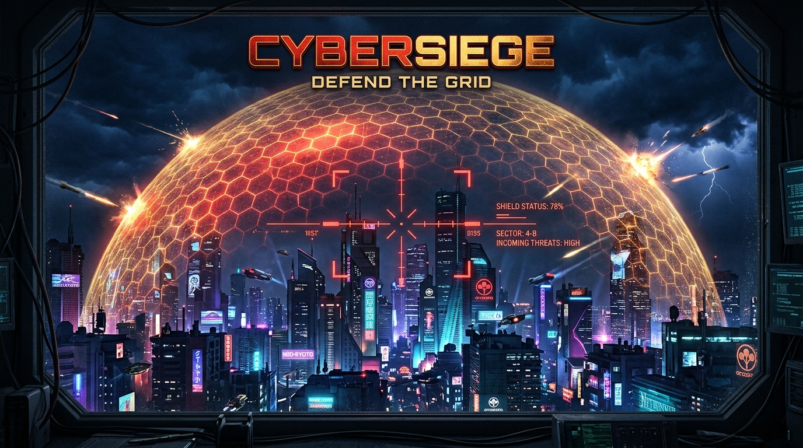
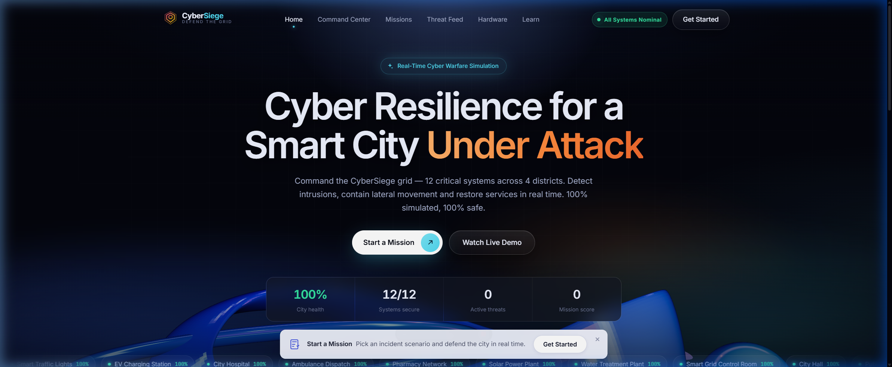
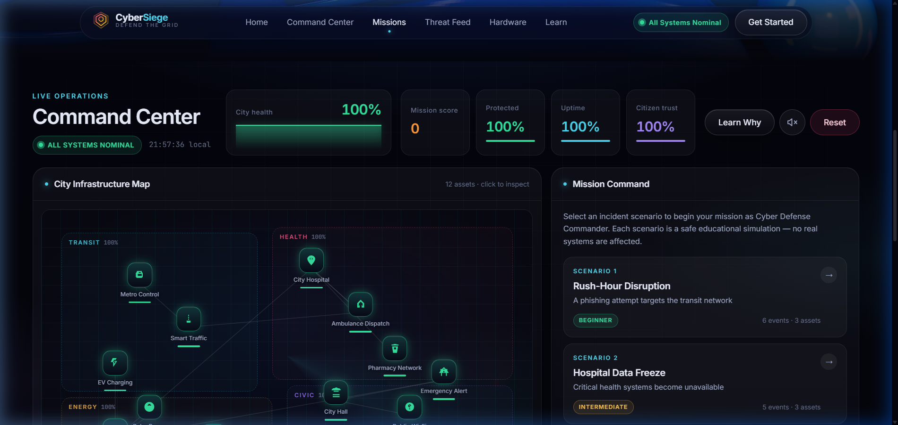
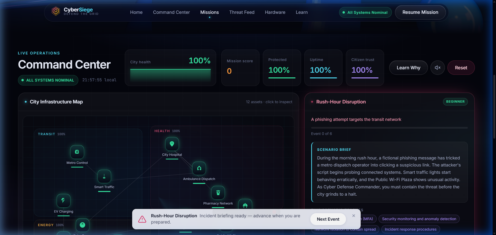
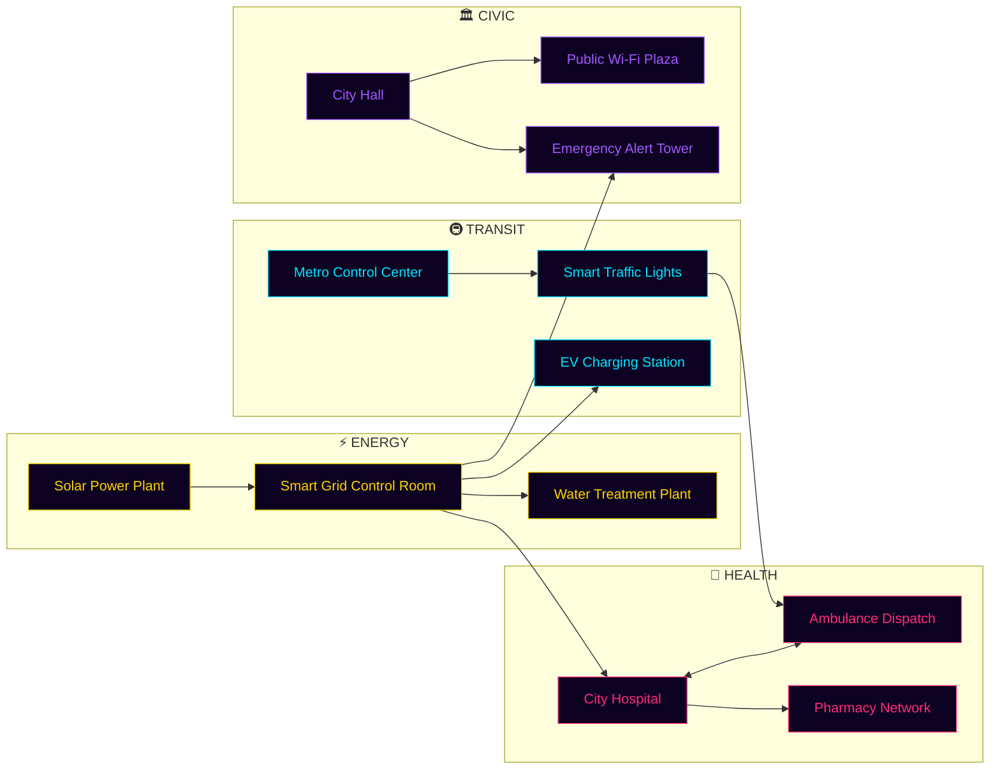
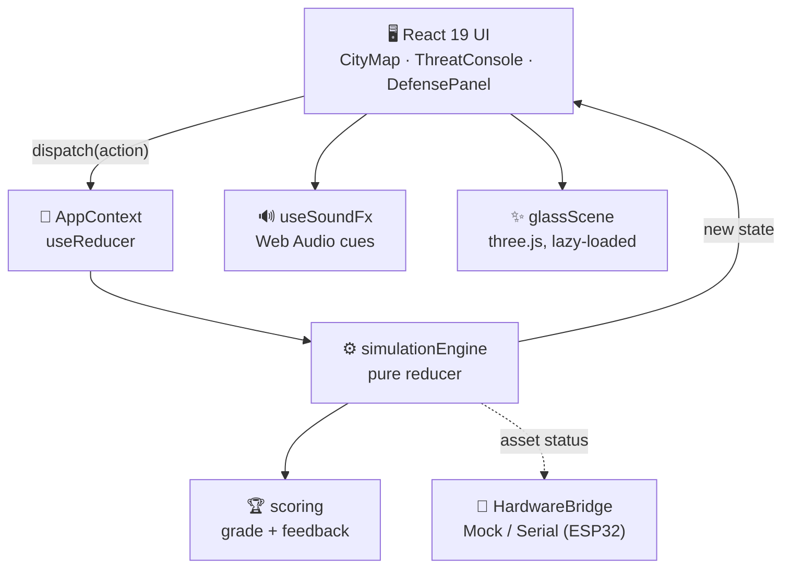

<!-- ═══════════════════════════════════════════════════════════════════ -->
<!--                    C Y B E R S I E G E                                -->
<!-- ═══════════════════════════════════════════════════════════════════ -->

<p align="center">
  
</p>

<p align="center">
  <a href="https://github.com/sarthakkandhare03/CyberSiege">
    
  </a>
</p>

<p align="center">
  <a href="https://sarthakkandhare03.github.io/CyberSiege/"></a>
  <a href="#-boot-sequence"></a>
  <a href="#-threat-briefings"></a>
  <a href="#-esp32-hardware-mode"></a>
</p>

<p align="center">
  
  
  
  
  
  
  
  
</p>

<p align="center">
  
</p>

```diff
- ALERT  >> 03:14:07  phishing payload executed on dispatch workstation
- ALERT  >> 03:14:22  lateral movement: METRO_CONTROL -> TRAFFIC_LIGHTS
! WARN   >> 03:14:40  public Wi-Fi plaza under active probe
+ DEFENSE>> 03:14:51  MFA enforced. attacker session terminated.
+ DEFENSE>> 03:15:03  network segmented. blast doors sealed.
@@ STATUS >> 03:15:10  grid stabilising... citizen trust recovering @@
```

---

## 💀 What Is This?

**CyberSiege** is a real-time cyber-warfare simulation. You are the **Cyber Defense Commander** of a living smart city, and its hospitals, metro, power grid and water supply are under attack *right now*.

Watch the alerts, read the threat console, and pick the right defense before the attack spreads to the next system. Every second you wait costs uptime, and every wrong move costs **citizen trust**.

<table>
<tr>
<td width="50%" valign="top">

### 🧠 Learn by surviving
Every defense has a **"Learn Why"** drawer that explains the real concept (MFA, segmentation, offline backups, patching, ICS/SCADA) in plain English.

### 🎮 Play like a game
Real-time KPIs, sparklines, a live threat console, synthesized sound cues and a WebGL glass hero scene that **turns from calm blue to hostile magenta** as the threat level rises.

</td>
<td width="50%" valign="top">

### 🛡️ 100% safe & ethical
Fully fictional. No real systems, no network calls, no exploits. Every log line is tagged `[SIMULATION]`. Built for **schools, expos and cyber clubs**.

### 🪶 Zero backend
No server, no database, no API keys. Pure static frontend, deployable to GitHub Pages in one push.

</td>
</tr>
</table>

> [!IMPORTANT]
> This is an **educational simulation**. Nothing in it touches, scans or attacks real infrastructure.

---

## 📸 Field Recon

<p align="center">
  
  <br/><sub><b>// 01 — THE CALM BEFORE THE STORM</b></sub>
</p>

<table>
<tr>
<td width="50%"><p align="center"><sub><b>// 02 — COMMAND CENTER</b><br/>Live KPIs, health sparklines, threat monitoring</sub></p></td>
<td width="50%"><p align="center"><sub><b>// 03 — UNDER SIEGE</b><br/>The grid is compromised. Every second counts.</sub></p></td>
</tr>
</table>

---

## ⚡ Boot Sequence

```bash
git clone https://github.com/sarthakkandhare03/CyberSiege.git
cd CyberSiege
npm install
npm run dev          # → http://localhost:5173
```

> [!TIP]
> Requires **Node.js 20.19+** (Node 22 LTS recommended).

| Command | What it does |
|---|---|
| `npm run dev` | 🚀 Launch the dev server with hot reload |
| `npm run build` | 🏗️ Type-check + production build → `dist/` |
| `npm run preview` | 👀 Serve the production build locally |
| `npm test` | 🧪 Run the Vitest suite (48 tests) |
| `npm run test:coverage` | 📊 Coverage report |
| `npm run lint` | 🧹 Lint with oxlint |

---

## 🗺️ The City

**12 critical systems** across **4 districts**, all live, interconnected and attackable.



<sub>Arrows show dependencies: when a system goes down, everything downstream feels it. Source: <a href="src/data/assets.ts"><code>src/data/assets.ts</code></a></sub>

---

## 🛡️ Your Arsenal

<table>
<tr><th>Defense</th><th>Use it when…</th><th>Real-world lesson</th></tr>
<tr><td>🩹 <b>Apply Security Patch</b></td><td>A known vulnerability is being exploited</td><td>Most breaches use bugs that already have fixes</td></tr>
<tr><td>🔐 <b>Enable MFA</b></td><td>Stolen credentials are in play</td><td>A password alone is not identity</td></tr>
<tr><td>🧱 <b>Segment Network</b></td><td>The attacker is moving sideways</td><td>Blast doors stop one breach becoming ten</td></tr>
<tr><td>🔌 <b>Isolate Asset</b></td><td>A system is actively compromised</td><td>Contain first, investigate second</td></tr>
<tr><td>💾 <b>Restore Backup</b></td><td>Data is encrypted or destroyed</td><td>Only offline backups survive ransomware</td></tr>
<tr><td>👁️ <b>Activate Monitoring</b></td><td>You need eyes on a system</td><td>You can't stop what you can't see</td></tr>
<tr><td>📢 <b>Notify Citizens</b></td><td>Public services are disrupted</td><td>Transparency protects trust</td></tr>
</table>

---

## 📡 Threat Briefings

<details>
<summary><b>🟢 SCENARIO 01 — Rush-Hour Disruption</b> &nbsp;<code>BEGINNER</code></summary>

<br/>

> A phishing email compromises a metro dispatch account. The attacker starts probing traffic lights and public Wi-Fi.

- **Targets:** Metro Control · Smart Traffic Lights · Public Wi-Fi Plaza
- **You'll learn:** MFA, isolation, monitoring

</details>

<details>
<summary><b>🟡 SCENARIO 02 — Hospital Data Freeze</b> &nbsp;<code>INTERMEDIATE</code></summary>

<br/>

> A ransomware-style attack freezes hospital records. Pharmacy and ambulance systems are going dark.

- **Targets:** City Hospital · Ambulance Dispatch · Pharmacy Network
- **You'll learn:** offline backups, segmentation, safe restoration

</details>

<details>
<summary><b>🔴 SCENARIO 03 — Blackout Protocol</b> &nbsp;<code>ADVANCED</code></summary>

<br/>

> An unpatched smart-grid vulnerability is exploited. Solar sensors, water treatment and the emergency alert tower are next.

- **Targets:** Smart Grid Control Room · Solar Power Plant · Water Treatment · Emergency Alert Tower
- **You'll learn:** patch management, ICS/SCADA security, infrastructure recovery

</details>

---

## 🏆 Scoring & Ranks

You're judged on four fronts: **Mission Score**, **Services Protected**, **Uptime** and **Citizen Trust**. At the end you get a mission report and a rank:

| Rank | Score | Verdict |
|:---:|:---:|---|
| 🥇 **A** | 120+ | *Outstanding work, Commander.* |
| 🥈 **B** | 90 – 119 | Solid response, room to be faster |
| 🥉 **C** | 60 – 89 | Systems lost, act earlier next time |
| ⚠️ **D** | 30 – 59 | Significant disruption |
| 💀 **F** | < 30 | *Critical failure. Try again.* |

---

## 🧬 Under the Hood



<details>
<summary><b>📁 Project structure</b></summary>

```
CyberSiege/
├── src/
│   ├── components/
│   │   ├── landing/            # Hero, Navbar, MissionDock, WebGL glass scene
│   │   ├── CityMap.tsx         # Interactive map of all 12 assets
│   │   ├── ThreatConsole.tsx   # Live event-log terminal
│   │   ├── MissionPanel.tsx    # Scenario playback + mission report
│   │   ├── DefensePanel.tsx    # Defense actions
│   │   ├── AssetDetails.tsx    # Selected asset intel
│   │   ├── LearningDrawer.tsx  # "Learn Why" explainers
│   │   ├── DashboardHeader.tsx # KPIs + sparklines
│   │   └── HardwareStatus.tsx  # LED mirror panel
│   ├── engine/                 # simulationEngine (reducer) + scoring
│   ├── data/                   # assets, scenarios, defenses
│   ├── hardware/               # HardwareBridge interface + Mock/Serial impls
│   ├── context/                # React Context + useReducer
│   ├── hooks/                  # useSoundFx, useCountUp, useNow, useCitySummary
│   ├── types/  utils/  styles/
│   └── tests/                  # Vitest suites
├── docs/                       # Screenshots + banner
└── .github/workflows/          # Lint → Test → Build → Deploy to Pages
```

</details>

| Layer | Tech |
|---|---|
| ⚡ Build | Vite 8 |
| ⚛️ UI | React 19 + TypeScript 6 |
| 🧠 State | `useReducer` + Context (pure, fully testable engine) |
| ✨ 3D | three.js, code-split so it never blocks first paint |
| 🔊 Audio | Web Audio API, synthesized with zero sound files |
| 🧪 Tests | Vitest |
| 🧹 Lint | oxlint |
| 🎨 Styling | Vanilla CSS + custom properties |
| 🚀 CI/CD | GitHub Actions → GitHub Pages |

---

## 🔌 ESP32 Hardware Mode

Build a **physical model city** with an LED in every building, wire it to an ESP32, and watch real lights flip red as attacks land in the app.

| Status | LED |
|---|---|
| 🟢 Secure | `#00ff88` |
| 🟡 Warning | `#ffd600` |
| 🔴 Compromised | `#ff2d78` |
| ⚫ Offline | `#000000` |
| 🟣 Recovering | `#a259ff` |

```json
{ "assetId": "metro_control", "status": "compromised", "health": 45 }
```

Ships with a `MockHardwareBridge` (on-screen LED panel) and a placeholder `SerialHardwareBridge` for Web Serial. See [`src/hardware/`](src/hardware/).

---

## 🚀 Deploy Your Own

Already wired up. Each push to `main` runs **lint → tests → build → deploy**.

1. Fork / push this repo to GitHub
2. **Settings → Pages → Source → GitHub Actions**
3. Push to `main` and you're live at `https://<you>.github.io/<repo-name>/`

> [!NOTE]
> The base path is set automatically from the repo name. To override it, set a `VITE_BASE_PATH` repository variable.

---

## 🎙️ 2-Minute Expo Demo Script

<details>
<summary><b>Click to expand. Perfect for science fairs & tech expos</b></summary>

<br/>

| ⏱️ | Do | Say |
|---|---|---|
| 0:00 | Landing page | *"This is CyberSiege. I'm the Cyber Defense Commander of this city."* |
| 0:15 | Show the map | *"12 systems: hospitals, traffic lights, power plants. Green is safe, red is under attack."* |
| 0:30 | Start Scenario 1 | *"A phishing attack just hit the metro. Watch it turn red."* |
| 0:50 | Enable MFA | *"Two-factor authentication kicks the attacker out. Health up, score up."* |
| 1:10 | Advance event | *"They're spreading to traffic lights, so I segment the network. Blast doors."* |
| 1:30 | Open "Learn Why" | *"Every defense explains the real-world concept in plain English."* |
| 1:45 | Mission report | *"At the end you get a grade. Can you get an A?"* |
| 2:00 | Hand over | *"Everything is simulated. Nothing touches real systems. Want to try?"* |

</details>

---

## 🤝 Contributing · 🔒 Security · 📜 License

- Contributions welcome. Read [CONTRIBUTING.md](CONTRIBUTING.md)
- Safe-use statement & policy: [SECURITY.md](SECURITY.md)
- [MIT](LICENSE): free to use, modify and share

<p align="center">
  <b>⭐ If CyberSiege kept your grid alive, drop a star. ⭐</b>
</p>

<p align="center">
  
</p>

<p align="center">
  <sub>Built with 🔥 for cybersecurity education by <a href="https://github.com/sarthakkandhare03">@sarthakkandhare03</a></sub>
</p>
